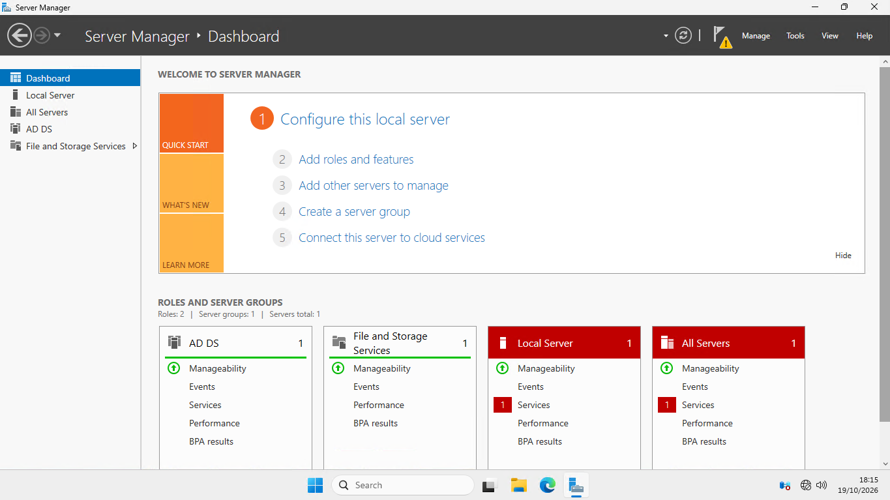
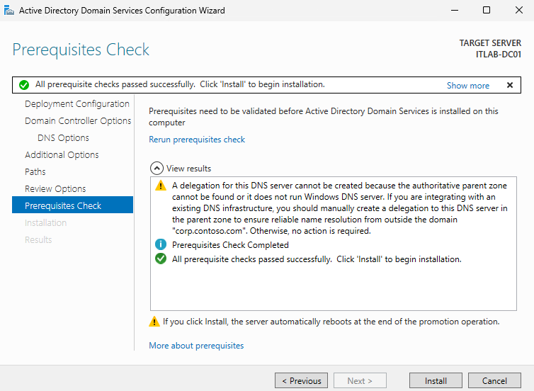
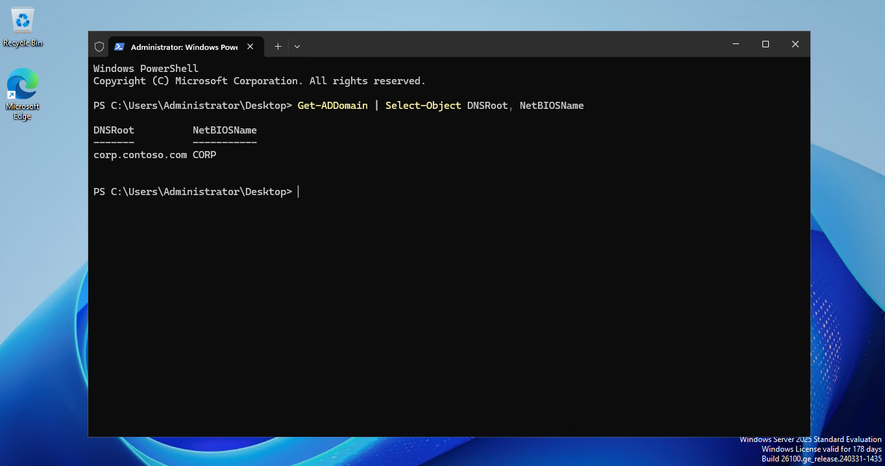
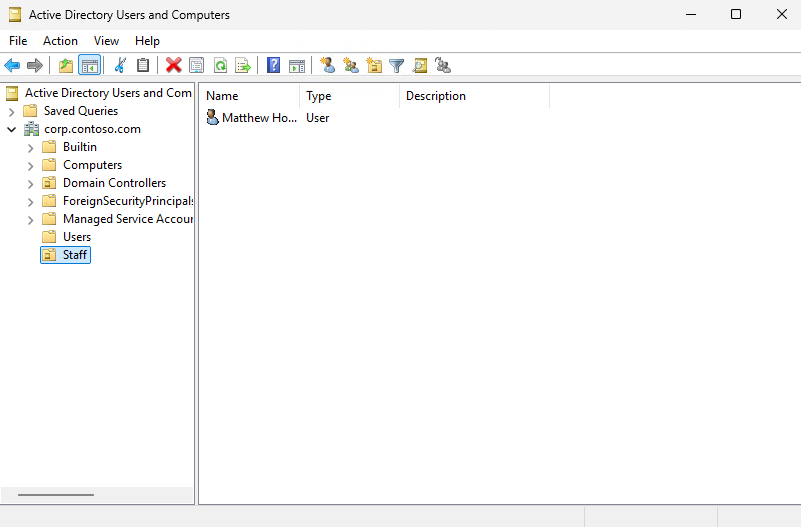
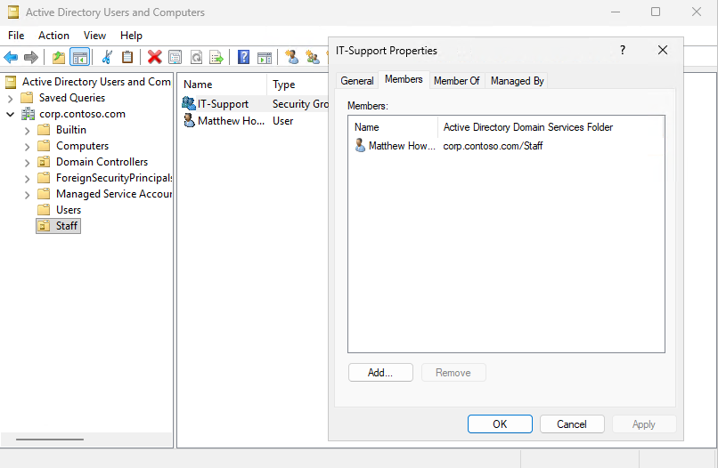
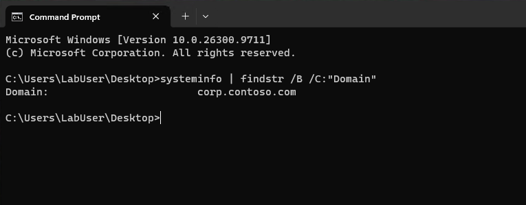
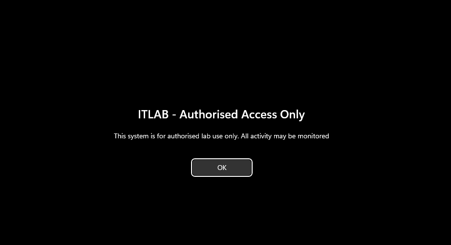

# Windows Server 2025 Active Directory Lab

A virtualised Windows Server 2025 lab built to practise core IT support and systems administration tasks, including Active Directory Domain Services (AD DS), Domain Name System (DNS), user and group management, domain joining, and Group Policy.

> **Lab status:** Core configuration completed. This is an isolated learning environment, not a production deployment.

## Objectives

- Deploy a Windows Server 2025 evaluation virtual machine in Hyper-V.
- Install and configure Active Directory Domain Services.
- Create an Active Directory domain and manage users, organisational units (OUs), and security groups.
- Connect a Windows 11 client to the domain.
- Configure and apply a Group Policy sign-in notice.
- Verify configuration and document troubleshooting.

## Lab architecture

| Component | Configuration |
|---|---|
| Hypervisor | Hyper-V on Windows 11 Pro |
| Virtual switch | `ITLAB` (Internal) |
| Domain controller | `ITLAB-DC01` |
| Client workstation | `ITLAB-CLIENT01` |
| Domain | `corp.contoso.com` |
| Domain controller IPv4 address | `172.20.50.10/24` |
| Client IPv4 address | `172.20.50.20/24` |
| Client DNS server | `172.20.50.10` |

Both virtual machines are connected to the same internal Hyper-V switch. The client has no default gateway configured for this isolated lab network.

### Network layout

```text
Windows 11 Pro host
└── Hyper-V
    └── Internal virtual switch: ITLAB
        ├── ITLAB-DC01
        │   ├── Windows Server 2025 Evaluation
        │   ├── Active Directory Domain Services
        │   └── IPv4: 172.20.50.10/24
        └── ITLAB-CLIENT01
            ├── Windows 11 Enterprise Evaluation
            ├── Domain member: corp.contoso.com
            └── IPv4: 172.20.50.20/24
                DNS: 172.20.50.10
```

## Implementation

### 1. Deploy the virtual machines

Created a Windows Server 2025 Evaluation virtual machine and a Windows 11 Enterprise Evaluation client in Hyper-V. Configured both virtual machines to use the `ITLAB` internal switch so they could communicate on the private lab network.

**Screenshot 1: Server role installation**


Screenshot showing the Active Directory Domain Services server role installed.

**Screenshot 2: Prerequisite checks**


Screenshot showing the Active Directory Domain Services prerequisite checks.

### 2. Configure Active Directory Domain Services

Installed the Active Directory Domain Services role and promoted the server to a domain controller for:

`corp.contoso.com`

The domain controller uses the static IPv4 address `172.20.50.10/24`.

**Screenshot 3: Domain created**


Screenshot showing the domain creation or domain controller configuration.

### 3. Organise users and groups

Created the following Active Directory objects:

- **Staff** organisational unit, for staff user accounts.
- **Workstations** organisational unit, for workstation computer accounts.
- **Matthew Howard** user account, used to test domain sign-in.
- **IT-Support** security group, with Matthew Howard added as a member.

The client computer object, `ITLAB-CLIENT01`, was moved into the `Workstations` organisational unit so that the workstation policy could be linked to the relevant OU.

**Screenshot 4: Active Directory users and computers**


Screenshot showing the OUs and user account.

**Screenshot 5: Security group membership**


Screenshot showing the IT-Support group and its membership.

### 4. Join the Windows 11 client to the domain

Configured the client with:

- IPv4 address: `172.20.50.20/24`
- DNS server: `172.20.50.10`
- Domain: `corp.contoso.com`

Confirmed that the client could resolve the domain to the domain controller address and signed in using the domain user account.

**Screenshot 6: Client domain membership**


Screenshot showing the Windows 11 client joined to the domain.

### 5. Apply a Group Policy sign-in notice

Created a Group Policy Object (GPO) named **Staff - Sign-in Notice** and linked it to the **Workstations** organisational unit.

Configured the policy in:

`Computer Configuration > Policies > Windows Settings > Security Settings > Local Policies > Security Options`

The interactive logon message uses the following title and text:

**Title**
`ITLAB - Authorised Access Only`

**Message**
`This system is for authorised lab use only. All activity may be monitored.`

Verified that `Staff - Sign-in Notice` appeared in the applied computer Group Policy list and that the sign-in notice appeared on the Windows login screen.

**Screenshot 7: Applied Group Policy**


Screenshot showing the sign-in notice on the Windows login screen.

## Verification

The following checks were completed during the lab build:

| Check | Expected result | Outcome |
|---|---|---|
| Client and server share the `ITLAB` virtual switch | Both virtual machines are attached to the same internal switch | Verified |
| Client DNS configuration | DNS points to `172.20.50.10` | Verified |
| Domain name resolution | `corp.contoso.com` resolves to `172.20.50.10` | Verified after correcting the virtual-switch connection |
| Domain user sign-in | User can sign in using the domain account | Verified |
| Computer Group Policy | `Staff - Sign-in Notice` appears in the applied computer GPO list | Verified |
| Sign-in notice | Notice is displayed at the Windows login screen | Verified |

Useful commands used during verification included:

```powershell
nslookup corp.contoso.com
whoami
$env:USERDOMAIN
gpresult /r /scope computer
```

Run the Group Policy Result command from an elevated Command Prompt or PowerShell session when checking computer policy, as required by the environment.

## Troubleshooting notes

### Domain name resolution initially failed

Initially, the virtual machines were connected to different Hyper-V virtual switches. The client could not reliably resolve the domain controller. Connecting both virtual machines to the same internal switch, `ITLAB`, resolved the network separation issue. After that, `corp.contoso.com` resolved to `172.20.50.10`.

**Lesson:** Check the virtual network attachment and DNS server address before troubleshooting Active Directory itself.

### Remote sign-in message appeared in the Hyper-V console

A message stated that the account needed the right to sign in through Remote Desktop Services. This appeared while connecting through Hyper-V Manager, not because the intended fix was to grant the domain user Remote Desktop permissions. Disabling Enhanced Session Mode and returning to a basic Hyper-V session allowed the domain sign-in to proceed.

**Lesson:** Distinguish a Hyper-V enhanced-session issue from a domain account or Group Policy permission problem.

## Skills demonstrated

- Hyper-V virtual machine deployment and virtual networking.
- Windows Server role installation and domain controller configuration.
- Active Directory domain, OU, user, and security group administration.
- Static IPv4 and DNS configuration.
- Joining a Windows client to an Active Directory domain.
- Group Policy creation, OU linking, and policy verification.
- Basic Windows troubleshooting and technical documentation.

